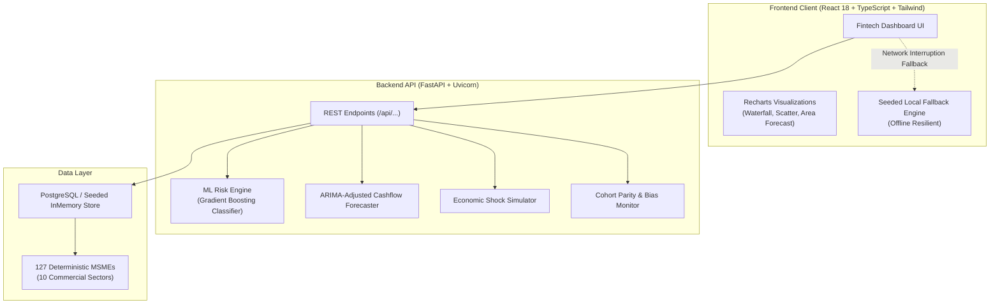
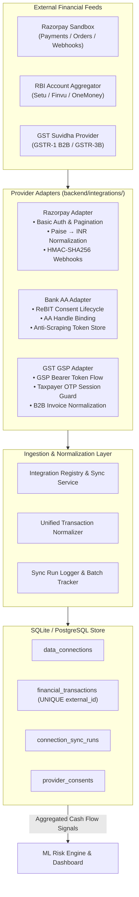

# CrediLens — MSME Credit Intelligence Platform

[](https://python.org)
[](https://fastapi.tiangolo.com)
[](https://react.dev)
[](https://www.typescriptlang.org)
[](https://tailwindcss.com)
[](LICENSE)

> **"Understand business risk beyond traditional credit scores."**
> A lender-facing decision-support analytics platform evaluating Micro, Small, and Medium Enterprises (MSMEs) through high-frequency alternative business data, explainable machine learning, rolling cash-flow forecasting, fairness audits, and interactive macroeconomic stress simulations.

---

## 📌 Executive Summary

Traditional commercial underwriting relies heavily on static, backward-looking credit bureau scores (e.g., CIBIL/Experian), audited annual financial statements, and collateral assets. This legacy framework routinely disadvantages creditworthy MSMEs that operate with thin collateral, seasonal cash cycles, or sparse formal credit histories.

**CrediLens** bridges this information asymmetry. By analyzing operational business signals—including daily cash flow volatility, invoice generation consistency, counterparty payment turnaround, buyer/supplier concentrations, and transactional density—CrediLens equips commercial credit underwriters with transparent, forward-looking credit intelligence.

> [!IMPORTANT]
> **Synthetic Demonstration Data Notice**: All enterprise names, financial statements, transaction histories, and risk metrics across this application are deterministically seeded synthetic data created strictly for prototype evaluation and algorithmic demonstration. This platform does not execute automated loan disbursements and is designed exclusively as a human-in-the-loop decision-support tool.

---

## 🏛 Architecture & Tech Stack



### Core Technologies
- **Frontend**: React 18, TypeScript, Tailwind CSS, Recharts, Lucide React icons, Vite 5
- **Backend**: Python 3.12, FastAPI, Uvicorn, Pydantic v2
- **Data Science & ML**: NumPy, Pandas, Scikit-learn (GradientBoostingClassifier), SHAP-style Transparent Feature Attribution
- **Database**: PostgreSQL support with hybrid in-memory seeded store for offline reliability

---

## 🚀 Key Functional Modules

### 1. Executive Portfolio Overview
- **6 Top KPI Cards**: Total MSMEs (`127`), Low Risk (`54`), Moderate Risk (`49`), High Risk (`24`), Average Risk Score (`57.4`), Portfolio at Risk (`18.6%`).
- **Portfolio Risk Distribution**: Interactive donut segmentation across credit tiers.
- **Portfolio Risk Migration**: 6-month historical trend line monitoring risk score trajectory.
- **Cash-Flow Health Gauge**: High-level liquidity split (`Healthy: 68`, `Watch: 38`, `Critical: 21`).
- **Top Risk Drivers**: Horizontal bar chart tracking portfolio-wide risk factor prevalence.
- **Recent Risk Alerts**: High-priority notifications (e.g., *Metro Auto Parts: Risk increased from 61 → 68*).

### 2. Searchable Borrower Portfolio
- High-density data grid containing 127 synthetic MSMEs across 10 commercial sectors (Automotive Components, Food Processing, Textiles, Electronics, Tools, etc.).
- Multi-dimensional filtering by Sector, Risk Segment, Annual Revenue Range, and Cash Flow Health with instant full-text search.

### 3. Deep-Dive Borrower Analysis (*Metro Auto Parts — MSME-1042*)
- **Composite Risk Rating Card**: Risk Score `68/100` (*Moderate-High*), Probability of Default `18.7%`, Cash Flow Stability `61%`, DSCR `1.24x`, Revenue Growth `-8.2%`.
- **Alternative Business Signals Grid**: 8 alternative operational metrics (Revenue Stability, Cash Flow Stability, Invoice Consistency, Payment Behavior, Business Activity, Customer/Supplier Concentration, Transaction Volatility).
- **Explainable AI (Why This Risk Score?)**: Horizontal contribution breakdown detailing positive risk contributors (+18 Cash volatility, +15 Revenue drop, +12 Debt burden) vs risk-reducing operational strengths (-11 Business activity, -8 Transaction consistency, -5 Supplier payments).
- **Loan Impact Simulator**: Live recalculation of debt service coverage (DSCR `1.24x` → `1.09x`), cash reserves (₹4.2L → ₹2.8L), and risk score (`68` → `73`) for proposed debt facilities (e.g., ₹10,00,000 @ 12% for 24 months).

### 4. Cash Flow Forecasting
- Historical monthly actuals vs 6-month predictive forecast with upper and lower 90% confidence bands.
- Tabular breakdown of Inflow, Outflow, and Net Cash Flow (October through March) identifying the December deficit trough (`-₹0.4L`).
- Algorithmic forecast insight highlighting seasonal working capital strain.

### 5. Portfolio Risk Segmentation Matrix
- Interactive 2D scatter quadrant mapping **Revenue Stability (X)** vs **Cash Flow Stability (Y)**.
- Bubble size scales with **Loan Exposure**; bubble color reflects **Risk Segment**.
- Clicking any bubble surfaces borrower financials and links to comprehensive underwriting analysis.

### 6. What-If Lab: Economic Stress Simulator
- Parametric shock sliders: Revenue Change (`-30%` to `+20%`), Operating Cost Change (`-10%` to `+30%`), Interest Rate Shift (`-2%` to `+6%`), and Receivables Payment Delays (`0` to `45 days`).
- 3 Instant Presets:
  1. **Stable Economy** (Revenue `+3%`, Costs `+2%`, Interest `0%`, Delay `0d` → Risk `64`, PD `16.2%`, DSCR `1.31x`)
  2. **Moderate Stress** (Revenue `-10%`, Costs `+8%`, Interest `+2%`, Delay `+15d` → Risk `72`, PD `21.8%`, DSCR `1.12x`, Reserve `₹3.1L`)
  3. **Severe Stress** (Revenue `-20%`, Costs `+15%`, Interest `+4%`, Delay `+30d` → Risk `84`, PD `34.6%`, DSCR `0.91x`, Reserve `₹1.4L`)
- Dynamic before/after comparison bar charts and stress analysis insights.

### 7. Fairness & Bias Monitor
- Audits model parity across synthetic partitions:
  - **Regional Cohort**: Region A vs Region B (Disparate Impact Ratio: `0.958` > `0.80` parity floor)
  - **Firm Maturity Cohort**: Business Age `< 5 Years` vs `≥ 5 Years` (Parity Ratio: `0.881` > `0.80`)
- Tracks Approval/Recommendation Rates, Mean Predicted Risk, False Positive Rates (FPR), and False Negative Rates (FNR).

### 8. Machine Learning Model Observability
- Live telemetry for **CrediLens Risk Engine v1.0** (Gradient Boosting Classifier).
- Benchmark validation metrics: **ROC-AUC: 0.86**, **Precision: 0.79**, **Recall: 0.74**, **F1: 0.76**.
- Gini feature importances: Cash Flow Volatility (26%), Revenue Trend (21%), Debt-to-Cash Ratio (17%), Payment Delays (14%), Invoice Consistency (12%), Business Activity (10%).

### 9. Credit Intelligence Report Generator
- One-click exportable and printable underwriting dossier.
- Structured decision support recommendations (*"Enhanced Underwriting Review"*), risk factors, positive mitigants, and cash flow outlook.

### 10. CrediLens Intelligence Assistant (Chatbot)
- Floating contextual copilot assisting underwriters in real-time.
- Answers borrower-level inquiries (*Why is Metro Auto Parts risky?*, *Explain DSCR*, *What happens under moderate stress?*, *Forecast review*) and portfolio queries (*Highest risk MSMEs*, *Model metrics*, *Fairness audit*).
- Uses currently selected borrower context dynamically without hardcoded responses.
- Displays data sources utilized for every answer.
- Operates in dual mode: **AI Assistant** when external LLM is configured, or **Demo Assistant** powered by a deterministic, data-driven fallback engine.

### 11. Data Management Hub: Connect Data Sources & Import Financial Data
A unified financial data management suite combining external API integrations with multi-format file ingestion:
- **Connect Data Sources (Multi-Provider Sandbox)**:
  - **Razorpay Payment Gateway (Test Mode / Sandbox)**: Real REST API integration for merchant settlements, payments, refunds, status breakdown, and HMAC-SHA256 verified webhooks with sub-unit (paise to INR) normalization and duplicate prevention.
  - **Bank Account Aggregator (ReBIT / Sahamati AA)**: Provider-independent consent lifecycle management (Setu / Finvu / OneMoney) with explicit consent requests, data scopes, and zero password/PIN scraping.
  - **GST Business Data (GSP Gateway)**: Authorized GST Suvidha Provider integration for GSTR-1 outward B2B sales invoices and GSTR-3B filing summaries with taxpayer OTP session enforcement.
- **Import Financial Data (CSV / Excel Ingestion Engine)**:
  - Drag-and-drop file ingestion supporting `.csv`, `.xlsx`, and `.xls` files up to 25MB.
  - Automatic column mapping using regex-based fuzzy keyword matching for Date, Amount, Direction, Balance, Reference ID, and Description across 6 dataset schemas (*Bank Statements*, *Revenue & Expenses*, *Invoices*, *Loan Repayments*, *GST Summary*, *Custom*).
  - Multi-gate validation engine verifying date formats, numeric amounts, required columns, and intra-file + DB-level duplicate detection.
  - Spreadsheet Formula Injection (CSV Injection) sanitization escaping cells starting with `=`, `+`, `-`, or `@`.
  - Downloadable CSV error reports itemizing row-by-row validation issues with field names and suggested remediations.
  - One-click rollback/deletion removing both the import record and all staged transactions.
- **Unified Financial Data Layer**: Single normalized ledger (`financial_transactions`) with clear provenance tags (`source="FILE_IMPORT"`, `RAZORPAY`, `ACCOUNT_AGGREGATOR`, `GST_GSP`) ensuring clean separation, borrower attribution, and zero double-counting.

### 12. Institutional User Authentication & Email OTP Recovery
A production-grade identity and access control system with dual-phase Gmail OTP verification, rate-limited resends, brute-force lockout, single-use signed password recovery tokens with replay protection, and one-click demo credentials.

### 13. Matte Black & Burnt Orange Fintech Design System
CrediLens is styled with an executive institutional visual language:
- **Application Canvas (`#0D0D0F`)**: Deep matte black backdrop for high-contrast financial data visualization.
- **Card & Surface Layer (`#171719` / `#1E1E21`)**: Elevated charcoal cards with crisp hairline borders (`#2A2A2E`) and subtle micro-elevations.
- **Brand Accent Orange (`#FF7A1A` / `#FF8F3D`)**: Burnt orange accents for CTAs, active indicators, and high-priority highlights.
- **Text Hierarchy**: Primary white (`#F5F5F5`), muted slate (`#A1A1AA`), and dimmed metadata (`#71717A`).
- **Financial Status Colors**:
  - **Low Risk / Solvent (`#22A477` / Emerald)**: Solvency status, mitigating factors, and healthy liquidity.
  - **Moderate Risk / Watch (`#E8A23A` / Amber)**: Watch status, forecast lines, and moderate risk tiers.
  - **High Risk / Critical (`#EF5350` / Crimson)**: Default risk badges, deficit warnings, and negative risk factors.
- **Typography & Numerals**: Inter sans-serif pairing with tabular numerals (`font-mono tabular-nums`) for currency and percentages.

---

## 💻 Local Setup & Execution Guide

### Prerequisites
- **Node.js** (v18+ or v20+)
- **Python** (v3.10+ or v3.12)
- **Git**

---

### Quick Start (One-Click Runners)

#### Windows PowerShell:
```powershell
# In terminal 1 (Backend):
.\run_backend.ps1

# In terminal 2 (Frontend):
.\run_frontend.ps1
```

#### Windows Command Prompt:
```cmd
# Terminal 1:
run_backend.bat

# Terminal 2:
run_frontend.bat
```

---

### Manual Setup Instructions

#### 1. Backend Service
```bash
# Navigate to backend directory
cd backend

# (Optional) Create and activate virtual environment
python -m venv venv
.\venv\Scripts\activate       # On Windows
# source venv/bin/activate    # On Linux/macOS

# Install dependencies
pip install -r requirements.txt

# Configure environment variables (create .env from .env.example)
copy .env.example .env

# Run comprehensive test suites
python test_file_imports.py   # 10 File Ingestion & Data Management Tests
python test_integrations.py   # 16 Financial Integrations & Sandbox Tests
python test_otp_auth.py       # 19 OTP & Recovery Tests
python test_auth.py           # 7 Authentication Tests
python test_api.py            # 12 Core Analytics Tests

# Launch FastAPI development server
python -m uvicorn main:app --host 127.0.0.1 --port 8000 --reload
```
The backend API is now running at `http://127.0.0.1:8000`. Interactive OpenAPI documentation is available at `http://127.0.0.1:8000/docs`.

#### 2. Frontend Application
```bash
# Navigate to frontend directory
cd frontend

# Install dependencies
npm install

# Build verification
npm run build

# Start Vite dev server
npm run dev
```
Open your browser at `http://localhost:5173`.

---

## 🔐 Institutional User Authentication & Email OTP Recovery

CrediLens incorporates a security-hardened authentication and identity recovery system designed for institutional credit underwriting teams:

### 1. Registration with Gmail OTP Verification
- **Dual-Phase Registration**: Submitting the registration form creates a pending verification record and dispatches a cryptographically secure 6-digit numeric OTP.
- **Unverified Account Lockdown**: Unverified registrations cannot authenticate until verified via OTP.
- **Interactive Verification UI**: Includes masked recipient email (`a***a@gmail.com`), auto-focusing 6-box inputs, auto-advance on keystroke, paste support, and a 60-second cooldown timer.
- **Instant Session Issuance**: Successful verification automatically creates the active account, invalidates the OTP, logs the user in, and establishes the authenticated session.

### 2. Password Recovery (Forgot Password)
- **Recovery OTP Request**: Users initiate password reset by submitting their registered email.
- **Anti-Enumeration Protection**: Generic response is returned regardless of whether the email exists, preventing unauthorized user enumeration.
- **Short-Lived Authorization Token**: Correct OTP verification yields a signed, single-use `reset_token` valid for 15 minutes.
- **Single-Use Replay Protection**: Each reset token incorporates a unique cryptographic `jti` recorded in `used_tokens` upon consumption, preventing replay attacks.
- **Immediate Invalidation**: Setting a new password invalidates the previous password and updates bcrypt hash with 12 salt rounds.

### 3. Security & Anti-Abuse Specifications
- **Real SMTP TLS Delivery**: Authenticated delivery via Gmail SMTP (`smtp.gmail.com:587` with STARTTLS) using multi-part plain text and branded dark-mode HTML templates.
- **Zero Simulation in Production**: Missing SMTP credentials explicitly return HTTP 503 Service Unavailable rather than silently faking email delivery.
- **HMAC-SHA256 Hashed Storage**: OTPs are never stored in plaintext. Verification uses HMAC-SHA256 with per-email salt and timing-safe comparison (`hmac.compare_digest`).
- **Brute-Force Lockout**: Verification allows at most 5 attempts before the OTP is invalidated.
- **Rate-Limited Resends**: Maximum 3 resends per session, enforced with a strict 60-second cooldown timer (`HTTP 429 Too Many Requests`).
- **Persistent Storage**: Robust SQLite schema (`credilens_users.db`) with tables for `users`, `pending_registrations`, `otp_verifications`, and `used_tokens` (PostgreSQL ready).
- **One-Click Demo Access**: Evaluators and hackathon judges can bypass email dispatch via the **Quick Demo Sign In** button:
  - **Demo Email**: `underwriter@credilens.internal`
  - **Demo Password**: `CrediLens@2026`
  - **Role**: Institutional Underwriter (CrediLens Underwriting)

---

### 📧 Setting Up Real Gmail SMTP Delivery

To enable real Gmail OTP delivery:

1. **Enable 2-Step Verification**: Go to your [Google Account Security Settings](https://myaccount.google.com/security) and ensure 2-Step Verification is active.
2. **Generate an App Password**:
   - Navigate to [Google App Passwords](https://myaccount.google.com/apppasswords).
   - Enter an app name (e.g. `CrediLens`).
   - Click **Create** and copy the 16-character generated password (e.g., `abcd efgh ijkl mnop`).
3. **Configure `backend/.env`**:
   ```env
   SMTP_HOST=smtp.gmail.com
   SMTP_PORT=587
   SMTP_USERNAME=your-email@gmail.com
   SMTP_APP_PASSWORD=your-16-char-app-password
   SMTP_FROM_EMAIL=your-email@gmail.com
   SMTP_FROM_NAME=CrediLens Underwriting Security
   ```
4. Restart the backend service. OTPs will now be delivered directly to the user's Gmail inbox!

---

## 💳 Financial Data Integration Hub (Live Sandbox & Providers)

CrediLens features an enterprise-grade financial data ingestion engine designed to continuously pull operational cash-flow indicators from external platforms and normalize them into the ML risk scoring engine.

### Integration Architecture Overview



---

### 1. Razorpay Payment Gateway (Test Mode / Sandbox)

- **Real Upstream Integration**: Interacts directly with the official Razorpay Payments REST API (`https://api.razorpay.com/v1/payments`) using HTTP Basic Authentication (`Key ID` + `Key Secret`).
- **Paise to Rupee Normalization**: Razorpay returns monetary values in integer sub-units (paise). CrediLens divides all raw amounts by 100.0 (`round(float(amount) / 100.0, 2)`) to ensure accurate financial reporting.
- **Idempotency & Duplicate Prevention**: The `financial_transactions` table enforces a composite `UNIQUE(provider, external_id)` constraint. Running repeated syncs updates existing records rather than inserting duplicate revenue entries.
- **HMAC-SHA256 Webhook Verification**: Real-time event ingestion (`POST /api/integrations/webhooks/razorpay`) validates the `X-Razorpay-Signature` against the configured `RAZORPAY_WEBHOOK_SECRET` using timing-safe comparisons to prevent replay or forgery attacks.
- **Empty State Guidance**: If a freshly generated Razorpay test account has 0 payments, CrediLens displays actionable instructions on how to generate a test payment or trigger a sample ingestion.

#### How to Obtain and Test Razorpay Sandbox Keys:
1. Log in to the [Razorpay Dashboard](https://dashboard.razorpay.com) and toggle to **Test Mode**.
2. Navigate to **Account & Settings** → **API Keys** → **Generate Key**.
3. Copy your `Key ID` (starts with `rzp_test_...`) and `Key Secret`.
4. Add them to `backend/.env` or configure them directly in the CrediLens UI via the **Configure** modal on the Data Connections page:
   ```env
   RAZORPAY_KEY_ID=rzp_test_YourKeyIdHere
   RAZORPAY_KEY_SECRET=YourSecretKeyHere
   RAZORPAY_ENVIRONMENT=sandbox
   ```
5. Click **Test Connection** to verify credentials, or click **Sync Now** to ingest test payments into the dashboard!

---

### 2. Bank Account Aggregator (ReBIT / Sahamati AA Framework)

- **Regulatory Compliance**: Built in strict adherence to RBI Master Directions for Account Aggregators. Supports major ecosystem providers including Setu, Finvu, and OneMoney.
- **Zero Scraping Guarantee**: CrediLens strictly forbids screen scraping, net banking password capture, or credential storage. Access is exclusively granted via digital consent artifacts.
- **Consent Lifecycle**: Underwriters can initiate consent requests (`POST /api/integrations/bank/consent`) specifying the borrower's VPA / AA handle (`borrower@finvu`), statement date range, and allowed data types (e.g., `TRANSACTIONS`, `SUMMARY`).
- **Status Guards & Transparency**:
  - Without provider onboarding, the adapter clearly reflects `NOT_CONNECTED` or `AWAITING_PROVIDER_SETUP`.
  - When running in local demonstration mode, records are strictly tagged with `source_environment="DEMO"` and `provenance="ACCOUNT_AGGREGATOR_DEMO"` so evaluators know it is offline test data.

---

### 3. GST Business Data (GST Suvidha Provider — GSP)

- **Authorized GSP Pipeline**: Integrates with authorized GSPs (such as Masters India, ClearTax, and Vayana) to retrieve tax compliance data directly from the GSTN portal.
- **GSTR-1 & GSTR-3B Ingestion**: Ingests B2B outward supply invoices (GSTR-1) and monthly tax liability summaries (GSTR-3B) to cross-verify reported revenue against tax filings.
- **Two-Factor Taxpayer Authorization**:
  > [!WARNING]
  > **Compliance Architecture**: Public GSTIN search APIs only reveal entity registration status and filing frequency. Legally retrieving private invoice data requires an active taxpayer session authenticated via mobile OTP dispatched to the registered business promoter.
- **State Enforcement**: The adapter displays `NOT_CONNECTED` until an authorized GSP Client ID and Client Secret are supplied.

---

### 4. Database Schema & Audit Trails

All financial data connections persist to `credilens_users.db` (or PostgreSQL in production):

| Table | Description |
| :--- | :--- |
| `data_connections` | Tracks configured providers, environment, masked secrets, sync health, and cumulative transaction counts. |
| `financial_transactions` | Master transaction ledger storing external ID, provider, normalized amount (INR), direction (CREDIT/DEBIT), status, counterparty, raw payload, file ID, and data source tag. |
| `connection_sync_runs` | Comprehensive audit trail logging every sync attempt, batch ID, records ingested, duration, and error codes. |
| `provider_consents` | Tracks borrower Account Aggregator consent handles, expiry dates, and lifecycle states (`ACTIVE`, `PENDING`, `EXPIRED`). |
| `imported_files` | Audit log of ingested statement files (`.csv`, `.xlsx`, `.xls`), dataset type, validation gate counts, borrower linkage, and execution state. |

---

## 🌐 API Specification

| Method | Endpoint | Description |
| :--- | :--- | :--- |
| `POST`| `/api/auth/register` | Initiates registration, stages pending user, and dispatches 6-digit OTP |
| `POST`| `/api/auth/verify-registration-otp` | Validates OTP, activates account, and issues JWT & session cookie |
| `POST`| `/api/auth/resend-registration-otp` | Dispatches fresh registration OTP subject to 60s cooldown & 3 resends |
| `POST`| `/api/auth/forgot-password` | Dispatches recovery OTP with anti-enumeration protection |
| `POST`| `/api/auth/verify-reset-otp` | Validates recovery OTP and issues 15-minute single-use reset authorization token |
| `POST`| `/api/auth/resend-reset-otp` | Dispatches fresh recovery OTP subject to cooldown |
| `POST`| `/api/auth/reset-password` | Consumes single-use reset token and securely updates bcrypt password hash |
| `POST`| `/api/auth/login` | Authenticates active credentials, sets HttpOnly cookie, returns JWT |
| `POST`| `/api/auth/logout` | Invalidates session cookie and terminates active session |
| `GET` | `/api/auth/me` | Validates session token / cookie and returns active underwriter profile |
| `GET` | `/api/overview` | Returns executive KPIs, risk distribution, trends, and recent alerts |
| `GET` | `/api/msmes` | Filterable and searchable portfolio list of all 127 MSMEs |
| `GET` | `/api/msmes/{id}` | Full profile and alternative business telemetry for single MSME |
| `GET` | `/api/msmes/{id}/risk` | Positive and negative feature contribution breakdown |
| `GET` | `/api/msmes/{id}/cashflow` | 6-month historical actuals and 6-month predictive forecast series |
| `POST`| `/api/simulate` | Evaluates macroeconomic stress shocks and recalculates risk/DSCR |
| `GET` | `/api/fairness` | Disparate impact and statistical parity audit across synthetic cohorts |
| `GET` | `/api/model-metrics` | ML model performance metrics, validation splits, and feature weights |
| `POST`| `/api/loan-impact` | Calculates proposed loan EMI, post-loan DSCR, and cash buffer impact |
| `GET` | `/api/report/{id}` | Formats full underwriting decision-support dossier |
| `POST`| `/api/chat` | Interactive contextual assistant answering questions about risk, cashflow, stress, and fairness |
| `GET` | `/api/data-management/summary` | Aggregated Data Management KPIs (connected providers, total files, transactions, quality status) |
| `POST`| `/api/imports/preview` | Uploads CSV/Excel, sanitizes formula injection, infers columns & dataset type |
| `POST`| `/api/imports/validate` | Validates mapped file, detects format errors, and checks for intra-file and DB duplicates |
| `POST`| `/api/imports/{file_id}/confirm` | Commits validated transactions to ledger tagged with `FILE_IMPORT` |
| `GET` | `/api/imports` | Audit list of all uploaded financial files and processing statistics |
| `GET` | `/api/imports/{file_id}` | Detailed file record and validation metrics |
| `GET` | `/api/imports/{file_id}/error-report` | Downloads CSV error report itemizing row-level validation issues |
| `DELETE`| `/api/imports/{file_id}` | Rollback deletion of imported file record and associated transactions |
| `GET` | `/api/msmes/{id}/data-summary` | Aggregated data feeds overview for specific borrower across AA, GST, and files |
| `GET` | `/api/integrations` | Returns overview of all registered integrations, live KPIs, statuses, and audit summaries |
| `GET` | `/api/integrations/{provider}/status` | Returns live health, environment, and masked credential status for provider |
| `POST`| `/api/integrations/{provider}/test` | Tests provider credentials against upstream sandbox API without persisting data |
| `POST`| `/api/integrations/{provider}/sync` | Ingests, normalizes (paise→INR), and idempotently stores transactions |
| `GET` | `/api/integrations/{provider}/sync-history` | Retrieves historical audit trail of synchronization batches and status codes |
| `GET` | `/api/integrations/transactions` | Filterable, paginated query of normalized financial transactions across all feeds |
| `POST`| `/api/integrations/{provider}/configure` | Securely stores provider credentials with secret redaction and masking |
| `POST`| `/api/integrations/bank/consent` | Initiates RBI ReBIT-compliant Account Aggregator consent workflow for borrower |
| `GET` | `/api/integrations/bank/consent/{consent_id}` | Polls consent status (`PENDING`, `ACTIVE`, `REJECTED`, `EXPIRED`) from AA provider |
| `POST`| `/api/integrations/webhooks/{provider}` | Ingests real-time transactional webhooks with HMAC-SHA256 signature verification |

---

### ⚙️ Optional AI Provider Configuration
The chatbot works out of the box with zero external dependencies using the built-in deterministic intelligence engine (**Demo Assistant**). To connect an external LLM (**AI Assistant**), configure the following environment variables in the backend environment:

```bash
# Windows PowerShell example:
$env:LLM_API_KEY = "your-api-key-here"
$env:LLM_PROVIDER = "openai_compatible"
$env:LLM_MODEL = "gpt-4o-mini"
$env:LLM_BASE_URL = "https://api.openai.com/v1"

# Windows Command Prompt example:
set LLM_API_KEY=your-api-key-here
set LLM_PROVIDER=openai_compatible
set LLM_MODEL=gpt-4o-mini
set LLM_BASE_URL=https://api.openai.com/v1
```

---

## 🧭 Judge Demonstration Flow (Recommended 3-Minute Walkthrough)

1. **Landing Entry Screen**: Launch `http://localhost:5173`. Review the problem statement overview and click **Analyze a Business**.
2. **Borrower Detail (Metro Auto Parts)**:
   - Observe default selected borrower **Metro Auto Parts** (`MSME-1042`, Automotive Components).
   - Review Risk Score **68/100** (*Moderate-High Risk*), PD **18.7%**, and DSCR **1.24x**.
3. **Alternative Business Signals**: Inspect the 8 operational signal cards (Cash Flow Stability `61%`, Invoice Consistency `78%`, Transaction Volatility `High`).
4. **Explainable AI (Why This Risk Score?)**:
   - Inspect the horizontal waterfall bars. Note the risk increasers (*Cash-flow volatility +18*, *Revenue decline +15*) vs risk reducers (*Business activity -11*).
5. **Cash Flow Forecast**: Click **Cash Flow** on the sidebar or header. Review the 6-month table and chart showing the seasonal dip in December (`-₹0.4L net cash flow`).
6. **What-If Lab (Economic Stress Simulator)**:
   - Navigate to **What-If Lab**.
   - Click the preset **2. Moderate Stress** (Revenue `-10%`, Costs `+8%`, Interest `+2%`, Delay `+15 days`).
   - Click **RUN SIMULATION**.
   - Observe the live recalculation: Risk Score climbs from **68 → 72**, PD increases to **21.8%**, Cash Reserve compresses from **₹4.2L → ₹3.1L**, and DSCR drops to **1.12x**.
7. **Fairness Monitor**: Open **Fairness Monitor** to view regional and business age disparate impact parity audits (`0.958` and `0.881` parity ratios).
8. **Loan Impact & Decision Support**:
   - Return to **Borrower Analysis**.
   - Scroll to **Loan Impact Simulator** (₹10,00,000 @ 12% for 24 months). Review EMI (`₹47,073/mo`) and post-loan DSCR (`1.09x`).
   - Click **Generate Credit Intelligence Report**.
   - Inspect the decision support recommendation: *"Enhanced Underwriting Review"*.

---

## 🔒 Ethical AI & Compliance Principles

1. **Non-Discriminatory Alternative Data**: Protected personal demographics (gender, religion, ethnicity, caste) are strictly excluded from the feature space. Audits evaluate non-protected synthetic partitions (firm maturity, regional clusters).
2. **Transparent Explainability**: Every score can be deconstructed into explicit positive and negative point attributions, avoiding black-box rejection.
3. **Human-in-the-Loop Governance**: CrediLens acts strictly as a decision-support platform. The engine provides recommended review tiers (*"Enhanced Underwriting Review"* or *"Further Assessment"*) rather than autonomous automated credit rejection.

---

## 🔮 Future Roadmap

- **Account Aggregator (AA) Integration**: Native integration with open banking APIs (e.g., Sahamati / Setu) for consented real-time bank statement ingestion.
- **GST e-Invoice API Feeds**: Direct verification against Goods and Services Tax Network (GSTN) returns for fraud detection and counterparty circular-trading flags.
- **Dynamic Early-Warning Early Intervention**: Webhook alerts notifying relationship managers when receivables delays cross 30 days.

---

## 📄 License
This project is licensed under the MIT License — see the [LICENSE](LICENSE) file for details.
